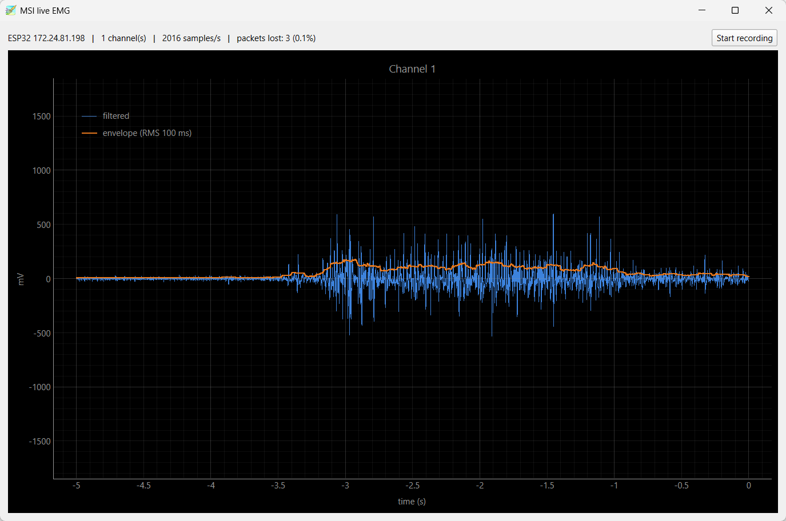
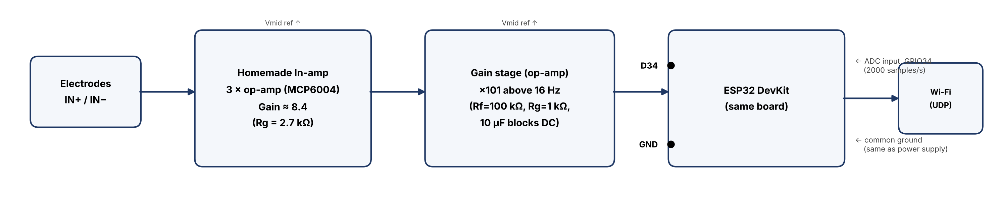
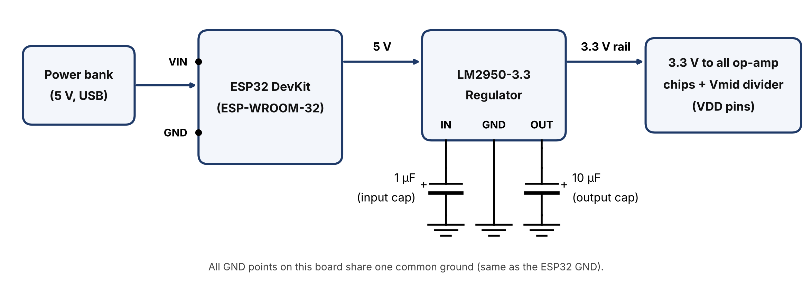
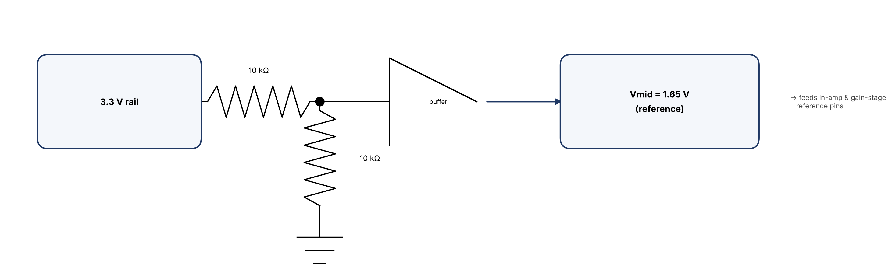

# MSI — Muscle Signal Interface

A wireless, single-channel surface EMG (electromyography) amplifier, built from discrete op-amps rather than a ready-made instrumentation-amplifier chip — plus the ESP32 firmware and Python app that turn it into a live, loggable signal on a laptop.

**Status:** channel 1 is complete and measured end to end: analog front end, ESP32 firmware, Wi-Fi streaming, live app, and a real forearm EMG recording. Channel 2, gesture recognition, a 3D hand, a SPICE model and a PCB are planned next. See [ROADMAP.md](ROADMAP.md).



*One fist clench, live from the ESP32 (blue: filtered signal, orange: 100 ms RMS envelope). About 0.16 mV RMS at the skin, 15–25× the resting level.*

## Why

Surface EMG amplifiers are usually built around a single off-the-shelf instrumentation-amplifier chip. This one is built from first principles instead — three ordinary op-amps, a handful of resistors and capacitors — to understand what every part does, and to measure and verify every number rather than trust a datasheet. That paid off: see [`docs/clone_chip_investigation.md`](docs/clone_chip_investigation.md) for a bought part that turned out not to behave like its marking.

## How it works

See [`docs/theory.md`](docs/theory.md) for the full explanation. Short version:

```
electrodes → in-amp (×8.4, rejects hum) → gain stage (×101, blocks DC drift)
           → ESP32 (2 kHz ADC + digital filters) → Wi-Fi → laptop (live plot + logging)
```

| | |
|---|---|
|  |  |
|  | |

## Results

| Measurement | Value |
|---|---|
| Total gain | ≈ 850 (design 841) |
| Input-referred noise | ≈ 2.8 µV RMS |
| CMRR | ≈ 91 dB |
| Real EMG, fist clench vs. rest | 15–25× |
| Wireless link | ≈ 2015 samples/s, 0.1–0.8% packet loss |

Full numbers, the method, and a comparison with a bought chip: [`docs/results.md`](docs/results.md). Raw logs are in [`data/`](data/), including the known-bad rows.

## Running it

1. Flash `firmware/emg_stage4_wifi/` to an ESP32 (set your Wi-Fi name and password at the top of the sketch first).
2. `pip install -r requirements.txt`
3. `python software/msi_live.py` — live plot, a measure panel (RMS, peak-to-peak, 100 Hz tone via FFT), and CSV logging.

## Safety

With electrodes on a person, power the board only from a USB power bank and send data over Wi-Fi. Never connect it to a laptop or a wall-powered USB port while electrodes are on.

## Repo layout

- `hardware/` — schematics, bill of materials, regulator notes
- `firmware/` — ESP32 sketches (USB-serial bring-up version, Wi-Fi streaming version)
- `software/` — `msi_live.py`, the live-plot and logging app
- `data/` — raw measurement logs and notes on which rows are invalid
- `docs/` — theory, results, FAQ, troubleshooting, demo script
- `ROADMAP.md` — what is planned next

## Roadmap

From mid-December 2026: a second channel, labelled gesture data and a classifier, a 3D hand that mirrors the predicted gesture, a SPICE model compared against these measurements, and a PCB. None of that is built yet; details in [ROADMAP.md](ROADMAP.md).
