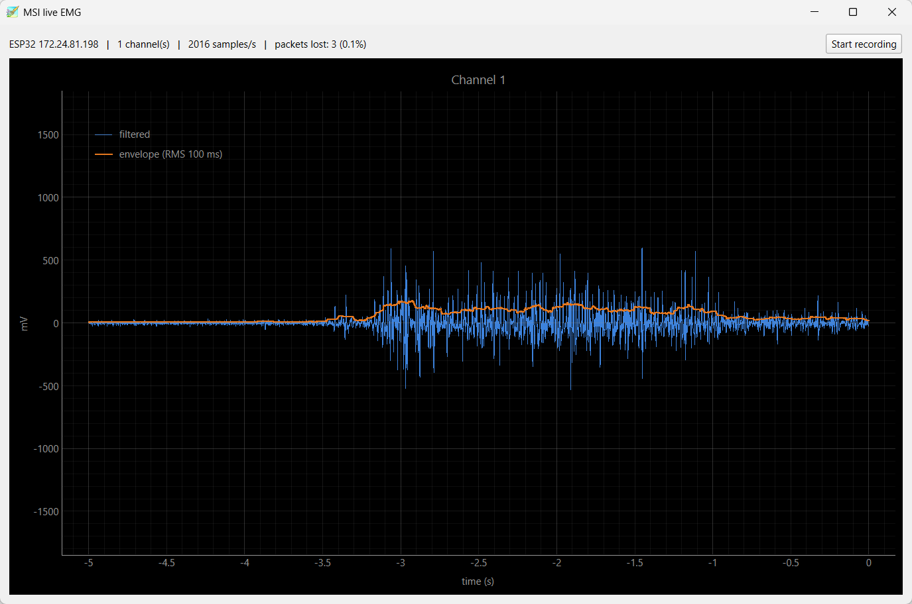
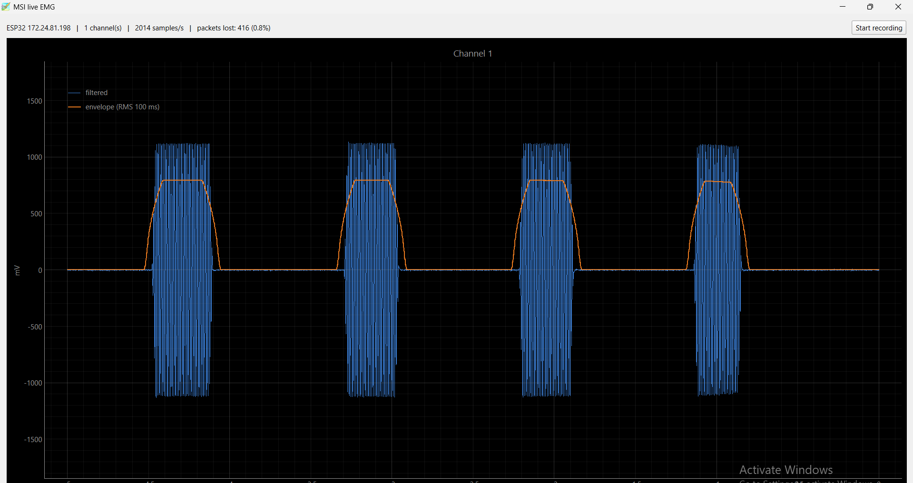

# Measured results

## Supply and bias

| Quantity | Measured |
|---|---|
| 3.3 V rail | 3.294 V |
| Vmid | 1.650 V |
| All op-amp outputs at rest | 1.65 V (= Vmid) |

## Gain

With a 0.998 mV (RMS) test tone at 100 Hz applied to the input:

| Stage | Expected | Measured |
|---|---|---|
| In-amp (G₁) | 8.41 (design) | ≈ 8.4 |
| Overall (G₁ × G₂) | ≈ 850 | 850 (0.848 V output) |

The real-EMG figure below uses a total gain of 832, from an earlier measurement of the same circuit on a different day; the two agree within about 2%.

## Noise

Input-referred noise (output noise with no signal, divided by the gain, with the measurement system's own noise floor subtracted): **≈ 2.8 µV RMS** — small next to the ≥0.1 mV EMG signals being measured.

## CMRR

With the same 90.9 mV, 100 Hz signal applied equally to both inputs (a common-mode signal, simulating hum), the surviving output was 2.07 mV:

```
CMRR = 20 · log10(gain / common-mode gain) ≈ 91 dB
```

An earlier CMRR run used a 1 V common-mode signal and gave only about 62.5 dB. That test drives the inputs close to the supply rails, so it is a large-signal result and not a fair CMRR figure; the 90.9 mV test above is the one to quote. The worst case for 1% resistors is about 52 dB on paper; the four subtractor resistors were hand-matched, which is why the measured value beats it.

91 dB means the wanted (differential) signal is amplified about 36,000× more than common hum — why the live display stays clean even near mains-powered equipment.

## Real EMG



One fist clench, streamed live (blue: filtered signal, orange: 100 ms RMS envelope).

With electrodes on the forearm flexor muscles: resting signal a few millivolts at the amplifier output, rising to 120–150 mV RMS during a fist clench — a 15–25× increase. Referred back to the skin (dividing by the measured gain of 832): **≈ 0.16 mV RMS during contraction**, in line with published surface-EMG amplitudes.

## Test-tone reference



The same chain fed a known 100 Hz tone through a ÷1011 divider (about 1 mV at the input), switched on and off. This is the signal used for the gain, noise and CMRR numbers above.

## Comparison with a bought chip

A chip marked AD623 was measured on the same bench; see [clone_chip_investigation.md](clone_chip_investigation.md).

| | Homemade | Bought chip |
|---|---|---|
| In-amp gain | ≈ 8.4 | ≈ 4.7 (RG 12.87 kΩ) |
| Total gain | 850 | 475 |
| Input-referred noise | 2.8 µV RMS | 7.4 µV RMS, spikier |
| CMRR (90.9 mV, 100 Hz) | ≈ 91 dB | ≈ 100 dB |

The bought chip rejects hum better, as expected from laser-trimmed resistors, but is noisier at this gain. Raw logs: [data/](../data/).

## Wireless link

2014–2016 samples/s received (target: 2000), 0.1–0.8% packet loss.

## Known sources of error

- 5% tolerance resistors in the gain-setting positions cause up to ~±4.5% gain variation from the design value.
- Electrode-skin contact quality varies with skin prep and pressure between sessions.
- Multimeter measurement uncertainty, especially at small AC voltages.
- Breadboard contact resistance and stray capacitance add a small amount of extra noise versus a soldered/PCB build.
